# Pipeline Otomasi Akuntansi Enterprise & Browser Web ERP

[](README.md)
[](LICENSE)
[](https://www.python.org/downloads/)
[](SKILL.md)

Pipeline otomatisasi akuntansi enterprise yang menghubungkan perayapan web ERP via browser controller (Lightpanda / Chrome CDP), pengunduhan laporan spreadsheet dan PDF dalam jumlah besar secara aman dengan validasi kriptografi, ingesti otomatis ke basis data SQL berpresisi tinggi, audit rekonsiliasi ganda (*Dual-Dimension: Finansial & Kuantitas Fisik*), hingga pembaruan berkas database Excel master berukuran besar tanpa merusak formula dan dengan integritas mutlak (*Zero Data Fabrication*).

---

## 🏛️ Arsitektur Alur Kerja Pipeline

```mermaid
flowchart TD
    subgraph Fase1["1. Penarikan Data Web ERP Masif"]
        ERP["🌐 Portal Web ERP / Keuangan"] --> BROWSER["🤖 Headless / Live Browser Controller<br/>(Lightpanda CDP / Chrome)"]
        BROWSER --> BATCH["📥 Penarikan Massal (Bulk Reports):<br/>- Iterasi Seluruh Cabang / Entitas<br/>- Rentang Tanggal Harian/Bulanan<br/>- Transaksi Penjualan, Pembelian & Stok"]
    end

    subgraph Fase2["2. Validasi Biner & Katalog Manifest"]
        BATCH --> DL["📂 Direktori Unduhan (/downloads)"]
        DL --> MAGIC["🛡️ Validasi Magic Bytes (PK, PDF)<br/>& Deduplikasi Hash (MD5/SHA-256)"]
        MAGIC --> MANIFEST["📑 Katalog Manifest Terstruktur<br/>(manifest.json & manifest.csv)"]
    end

    subgraph Fase3["3. Ingesti SQL Dinamis Berkecepatan Tinggi"]
        MANIFEST --> PARSER["📊 Parser Data Mentah (openpyxl / pdfplumber)"]
        PARSER --> DYN_SQL["🗄️ Pembuat Skema SQL Otomatis<br/>(DECIMAL 18,4 Anti Pembulatan Galat)"]
        DYN_SQL --> DB[("🐬 Basis Data Relasional<br/>(MySQL / SQLite / PostgreSQL)")]
    end

    subgraph Fase4["4. Audit Rekonsiliasi Dual-Dimension"]
        DB --> ENGINE["⚖️ Mesin Pencocokan Ganda:<br/>- Dimensi Finansial (Rupiah/Valas)<br/>- Dimensi Fisik (Kuantitas / Bobot / Satuan)"]
        ENGINE --> AUDIT["🔍 5-Pass Matching & Balance Proof<br/>(Ending = Beginning + IN - OUT)"]
    end

    subgraph Fase5["5. Pembaruan Master Spreadsheet Enterprise"]
        AUDIT --> MASTER["📑 Database Spreadsheet Master Induk<br/>(Multi-Sheet Data Warehouse)"]
        MASTER --> PRESERVE["🛡️ Mesin Proteksi Formula<br/>(Lindungi Header 1-5, Dynamic Fill Down)"]
        PRESERVE --> OUT["📈 Dashboard Eksekutif & Laporan Selisih"]
    end
```



---

## 💡 Mengapa Agen Bisa Menarik Laporan Masif dengan Sangat Andal?

Menarik puluhan hingga ratusan laporan secara otomatis dari portal web ERP sering kali gagal pada bot biasa karena form web modern dipenuhi AJAX dinamis, modal konfirmasi, dan proteksi sesi. Pipeline ini dirancang dengan **pemahaman mendalam terhadap struktur internal web (Deep Web Understanding)**:

### 1. Inspeksi Struktur DOM Dinamis (Bukan Sekadar Klik Buta)
* Agen membaca pohon elemen DOM secara presisi: elemen `<select name="store_id">`, elemen Select2, serta input tanggal `<input type="date">` diinspeksi atribut nilai aslinya, bukan menebak koordinat layar.
* Agen membaca seluruh daftar opsi cabang/gudang secara dinamis langsung dari HTML DOM, sehingga penambahan cabang baru di portal web akan otomatis terdeteksi tanpa perlu ubah kode.

### 2. Penanganan Asinkron & AJAX State (Anti-Gagal Dropdown)
* Saat cabang dipilih, web ERP umumnya memicu panggilan AJAX di latar belakang untuk memuat kategori barang atau baki kasir. Bot konvensional biasanya langsung mengeklik tombol *Cari/Export* sebelum AJAX selesai, mengakibatkan laporan kosong.
* Pipeline ini menerapkan mekanisme deteksi jeda *network-idle* dan verifikasi kesiapan DOM (0.5 – 1.5 detik) sebelum melakukan eksekusi unduhan.

### 3. Penanganan Otomatis Modal Dialog & SweetAlert2
* Banyak sistem ERP menampilkan modal konfirmasi JavaScript (seperti SweetAlert `.swal2-modal` atau `.swal2-confirm`) saat mengekspor laporan dalam jumlah baris besar.
* Agen secara otomatis mendeteksi keberadaan elemen modal dialog ini dan mengeklik tombol konfirmasi ekspor secara terprogram.

### 4. *Session Persistence* (Bypass Masalah Login & 2FA)
* Agen dapat berjalan menggunakan profil browser nyata (*live browser profile*) melalui remote debugging port (`ws://127.0.0.1:9222`).
* Sesi autentikasi, cookie, dan izin otorisasi yang sudah login tetap awet, sehingga proses penarikan puluhan laporan tidak terhenti oleh form login berulang atau tantangan OTP/2FA.

### 5. Filter Keamanan *Magic Bytes* (Menolak Halaman Error)
* Bila sesi login kedaluwarsa atau server web mengalami error 500, server web sering kali mengembalikan halaman HTML error yang secara keliru dinamai `.xlsx`.
* Pipeline memvalidasi tanda tangan biner file (*Magic Bytes*: `PK\x03\x04` untuk XLSX, `\xd0\xcf\x11\xe0` untuk XLS, dan `%PDF` untuk PDF). Berkas HTML palsu langsung digagalkan dan ditandai sebelum merusak database.

### 6. Katalogisasi Kriptografi (Deduplikasi MD5 & SHA-256)
* Setiap berkas yang diunduh dihitung nilai hash-nya. Jika berkas laporan untuk cabang dan tanggal tersebut identik dengan data yang sudah pernah ditarik sebelumnya, pipeline melewatinya secara cerdas untuk menghemat waktu dan kapasitas penyimpanan.

---

## 📖 Contoh Kasus Penggunaan Nyata (Real-World Usage Brief)

### Skenario: Penarikan Massal Laporan Harian 30 Cabang Toko
Sebuah perusahaan retail memiliki 30 cabang toko. Setiap pagi, staf akuntansi harus menarik 3 jenis laporan dari setiap cabang (Total: 90 berkas per hari):
1. **Laporan Penjualan (Sales):** Nomor faktur jual, kasir, kuantitas unit, dan penerimaan kas/bank/EDC.
2. **Laporan Pengadaan/Pembelian (Purchases/Payables):** Faktur beli, retur, dan hutang supplier.
3. **Laporan Saldo Persediaan (Live Stock Inventory):** Rincian fisik barang per barcode di etalase dan gudang.

#### Bagaimana Pipeline Menyelesaikannya Secara Mandiri:
1. **Langkah 1 (Ekstraksi Otomatis):**
   Agent membuka browser controller via CDP, melakukan loop ke 30 cabang satu per satu untuk ketiga jenis laporan, memilih filter tanggal kemarin, menangani dialog SweetAlert, dan mengunduh 90 berkas ke folder `downloads/`.
2. **Langkah 2 (Organisasi & Hash):**
   Organizer merapikan 90 berkas ke hierarki folder `structured_reports/2026-11/<cabang>/<jenis_laporan>/`, menghitung hash MD5/SHA-256, dan menyusun `manifest.json`.
3. **Langkah 3 (Ingesti SQL Cepat):**
   Parser membaca seluruh 90 berkas, membuat skema tabel dinamis dengan tipe `DECIMAL(18,4)` untuk kolom kuantitas dan nominal, lalu memasukkan puluhan ribu baris data ke database dalam hitungan detik.
4. **Langkah 4 (Audit Rekonsiliasi 5-Pass):**
   Algoritma mencocokkan data kasir lokal terhadap mutasi rekening bank dan buku besar pusat:
   * Menemukan nota cocok sempurna (*Exact Match*).
   * Menemukan transaksi dengan selisih nominal/diskon manual (*Discrepancy Match*).
   * Menemukan transaksi bergeser karena cut-off malam (*Timing Difference*).
   * Mendeteksi potensi nota gantung yang belum disetor ke pusat (*Unrecorded Risk*).
5. **Langkah 5 (Pembaruan Spreadsheet Master Enterprise):**
   Data inventaris live terbaru dimasukkan ke lembar kerja salinan master. Kolom formula pencarian (`VLOOKUP/XLOOKUP`) otomatis disalin ke bawah (*fill down*) tanpa merusak baris header atau memicu error `#REF!`.
6. **Langkah 6 (Laporan Eksekutif):**
   Menyajikan ringkasan eksekutif persentase kecocokan (% match rate) dan daftar anomali yang perlu ditindaklanjuti.

---

## 🛠️ Panduan Menjalankan

### 1. Kloning Repositori & Instalasi Dependensi
```bash
git clone https://github.com/hardy-ayp/accounting-browser-pipeline.git
cd accounting-browser-pipeline
pip install -r requirements.txt
```

### 2. Konfigurasi Lingkungan
Salin file konfigurasi contoh:
```bash
cp .env.example .env
```

### 3. Menjalankan Pengujian Otomatis (Unit Tests)
Jalankan pengujian unit bawaan:
```bash
python -m unittest tests/test_pipeline.py
```
Hasil:
```text
....
----------------------------------------------------------------------
Ran 4 tests in 0.014s

OK
```

### 4. Contoh Pemanggilan Python API
```python
from decimal import Decimal
from src.reconciler import reconcile_records, verify_balance_proof

# Data transaksi catatan cabang lokal
subledger = {
    "INV-1001": {"quantity": Decimal("10.00"), "amount": Decimal("15000000"), "date": "2026-11-01"},
    "INV-1002": {"quantity": Decimal("25.50"), "amount": Decimal("38250000"), "date": "2026-11-01"}
}

# Data transaksi rekapitulasi buku besar pusat
general_ledger = {
    "INV-1001": {"quantity": Decimal("10.00"), "amount": Decimal("15000000"), "date": "2026-11-01"},
    "INV-1002": {"quantity": Decimal("25.50"), "amount": Decimal("38000000"), "date": "2026-11-01"} # Ada selisih 250.000
}

# Jalankan 5-Pass Reconciliation
hasil = reconcile_records(subledger, general_ledger)
print("Transaksi Klop Sempurna :", len(hasil["matched"]))
print("Transaksi Selisih Nilai :", len(hasil["discrepancies"]))

# Jalankan Pembuktian Saldo (Balance Proof)
bukti = verify_balance_proof(
    beginning_balance=Decimal("1000.00"),
    total_inflows=Decimal("5000.00"),
    total_outflows=Decimal("4500.00"),
    actual_ending_balance=Decimal("1500.00")
)
print("Status Saldo Seimbang   :", bukti["is_balanced"])
```

---

## 🤖 Pemanfaatan sebagai AI Agent Skill

Repositori ini telah dilengkapi dengan berkas [SKILL.md](SKILL.md) standar agen kecerdasan buatan. Agen AI mana pun (seperti Antigravity, Claude Code, Cursor, atau custom LLM agent) dapat langsung memanggil skill ini dengan meletakkannya di folder `.agent/skills/accounting-browser-pipeline/`.

Ketika agen AI diberikan instruksi:
> *"Tarik seluruh laporan penjualan dan stok berjalan dari portal web ERP untuk seluruh cabang minggu ini, cocokkan dengan buku besar pusat, dan perbarui master spreadsheet."*

Agen AI akan secara otomatis mematuhi seluruh panduan operasional di [SKILL.md](SKILL.md), menghindari pengarangan data (*Zero Data Fabrication*), dan menyelesaikan audit secara terstruktur.

---

## ⚖️ Lisensi & Kepatuhan Etika

* **Lisensi Kode:** Permissive Open Source License. Lihat berkas [LICENSE](LICENSE).
* **Kepatuhan Merek Dagang:** Seluruh nama merek pihak ketiga (*Lightpanda, Chrome, Excel, MySQL*) disebutkan murni untuk tujuan identifikasi teknis dan interoperabilitas (*Nominative Fair Use*).
* **Pakta Integritas:** Pengguna dan agen AI wajib mematuhi [Anti-Fabrication Manifesto](docs/anti-fabrication-manifesto.md) untuk menjaga keabsahan data finansial.
