# Autonomous Enterprise Accounting & Browser Automation Pipeline

[](https://github.com/placeholder-org/accounting-browser-pipeline/actions)
[](https://www.python.org/downloads/)
[](LICENSE)
[](SKILL.md)

An end-to-end autonomous pipeline connecting web ERP browser crawling (Lightpanda / Chrome CDP), automated spreadsheet and PDF report downloading with cryptographic verification, dynamic SQL database ingestion, multi-unit/dual-dimension financial reconciliation, subledger auditing, and enterprise spreadsheet master updates with strict zero data fabrication.

---

## 🏛️ System Architecture

```mermaid
flowchart TD
    subgraph Phase1["1. Web ERP Browser Ingestion"]
        ERP["🌐 Web ERP / Portal"] --> BROWSER["🤖 Headless / Live Browser<br/>(Lightpanda CDP)"]
        BROWSER --> REPORTS["📥 Download Financial Reports<br/>(Sales, Payables, Inventory)"]
    end

    subgraph Phase2["2. Cryptographic Cataloging"]
        REPORTS --> DL["📂 Raw Downloads (/downloads)"]
        DL --> ORG["🗂️ File Organizer & Hash Check<br/>(MD5 + SHA-256 Deduplication)"]
        ORG --> MANIFEST["📑 Structured Folders & Manifests<br/>(manifest.json & manifest.csv)"]
    end

    subgraph Phase3["3. Dynamic SQL Ingestion Engine"]
        MANIFEST --> PARSER["📊 Excel & PDF Parser<br/>(openpyxl & pdfplumber)"]
        PARSER --> DYN_SQL["🗄️ Dynamic Schema Generator<br/>(DECIMAL 18,4 High Precision)"]
        DYN_SQL --> DB[("🐬 Relational Database<br/>(MySQL / SQLite / PostgreSQL)")]
    end

    subgraph Phase4["4. Financial & Multi-Unit Reconciliation"]
        DB --> ENGINE["⚖️ Dual-Dimension Reconciliation:<br/>- Financial Dimension (Currency/IDR/USD)<br/>- Physical Dimension (Quantity/Weights/Units)"]
        ENGINE --> AUDIT["🔍 5-Pass Matching & Balance Proof<br/>(Subledger vs General Ledger)"]
    end

    subgraph Phase5["5. Enterprise Master Spreadsheet Updating"]
        AUDIT --> MASTER["📑 Master Enterprise Workbook<br/>(Multi-Sheet Data Warehouse)"]
        MASTER --> PRESERVE["🛡️ Formula Protection Engine<br/>(Protect Header & Lookups, Dynamic Fill Down)"]
        PRESERVE --> OUT["📈 Executive Audit Dashboard"]
    end
```



---

## ✨ Key Features

1. **Web ERP Browser Automation**:
   - Headless execution via Lightpanda CDP (`ws://127.0.0.1:9222`) or live browser profile with session persistence.
   - Dynamic iteration over multi-branch dropdowns, date filters, and export confirmation modals.
   - Strict file validation: Verifies binary Magic Bytes (`PK\x03\x04` for XLSX, `%PDF` for PDF) to reject error HTML pages.

2. **Cryptographic Cataloging & Deduplication**:
   - Computes MD5 and SHA-256 checksums on all incoming reports.
   - Automatically generates timestamped audit manifests (`manifest.json` and `manifest.csv`).

3. **Dynamic SQL Schema Inference**:
   - Automatically sanitizes messy column headers into valid SQL identifiers.
   - Enforces `DECIMAL(18,4)` precision on quantities, currency, and unit rates to eliminate floating-point rounding errors.
   - Executes batch parameterized inserts for high-throughput data processing.

4. **Dual-Dimension & Multi-Unit Reconciliation**:
   - Reconciles both **Monetary Values** and **Physical Units / Quantities** simultaneously.
   - Strictly isolates direct purchases (*Accounts Payable*) from consignment inventory (*Third-Party Deposits*).
   - **5-Pass Matching Engine**: Exact Match, Discrepancy Match, Timing Difference, Unrecorded in GL, and Missing in Subledger.
   - **Balance Proof Formula**: $\text{Ending Balance} = \text{Beginning Balance} + \sum \text{Inflow} - \sum \text{Outflow}$.

5. **Enterprise Master Spreadsheet Engineering**:
   - Safeguards massive multi-sheet workbooks against formula breakage (`#REF!`).
   - Protects header rows and reference lookup dictionaries (Rows 1–5).
   - Applies dynamic formula fill-down across calculation columns while refreshing raw data.

6. **Strict Zero Data Fabrication**:
   - Never injects artificial balancing figures (*plug-in residuals*).
   - Radical honesty on missing or discontinuous source data.
   - Evidence-based citation: Every reported number references document name, sheet, and exact 1-based visual row index.

---

## 📁 Repository Structure

```text
accounting-browser-pipeline/
├── .github/
│   └── workflows/
│       └── ci.yml             # Automated CI test suite
├── docs/                      # Technical references & guides
│   ├── dual-unit-accounting.md
│   ├── database-master-rules.md
│   ├── browser-erp-crawling.md
│   └── anti-fabrication-manifesto.md
├── src/                       # Core Python package
│   ├── __init__.py
│   ├── reconciler.py          # 5-pass matching & balance proof
│   ├── downloader.py          # Magic bytes & checksum calculator
│   └── schema_builder.py      # Column sanitizer & SQL DDL generator
├── tests/                     # Unit test suite
│   ├── __init__.py
│   └── test_pipeline.py
├── SKILL.md                   # AI Agent Skill Definition (Antigravity/Agentic AI)
├── .env.example               # Environment template
├── .gitignore                 # Git ignore configuration
├── LICENSE                    # Permissive open-source license
├── requirements.txt           # Python dependencies
└── README.md                  # Project documentation
```

---

## 🚀 Quickstart

### 1. Installation
Clone the repository and install dependencies:
```bash
git clone https://github.com/your-org/accounting-browser-pipeline.git
cd accounting-browser-pipeline
pip install -r requirements.txt
```

### 2. Environment Setup
Copy the example environment configuration:
```bash
cp .env.example .env
```

### 3. Running Unit Tests
Run the automated test suite:
```bash
python -m unittest tests/test_pipeline.py
```

### 4. Basic Python Usage

```python
from decimal import Decimal
from src.reconciler import reconcile_records, verify_balance_proof

# Subledger sample records
subledger = {
    "INV-1001": {"quantity": Decimal("10.00"), "amount": Decimal("15000000"), "date": "2026-11-01"},
    "INV-1002": {"quantity": Decimal("25.50"), "amount": Decimal("38250000"), "date": "2026-11-01"}
}

# General Ledger records
gl_records = {
    "INV-1001": {"quantity": Decimal("10.00"), "amount": Decimal("15000000"), "date": "2026-11-01"},
    "INV-1002": {"quantity": Decimal("25.50"), "amount": Decimal("38000000"), "date": "2026-11-01"}
}

# Run 5-Pass Reconciliation
report = reconcile_records(subledger, gl_records)
print("Matched:", len(report["matched"]))
print("Discrepancies:", len(report["discrepancies"]))

# Verify Balance Proof
proof = verify_balance_proof(
    beginning_balance=Decimal("1000.00"),
    total_inflows=Decimal("5000.00"),
    total_outflows=Decimal("4500.00"),
    actual_ending_balance=Decimal("1500.00")
)
print("Is Balanced:", proof["is_balanced"])
```

---

## 🤖 Using as an AI Agent Skill

This repository includes a compliant [SKILL.md](SKILL.md) file. Any AI agent (such as Antigravity, Claude Code, or custom OpenAI/Gemini assistants) can load this skill directly by pointing to this directory or copying it into `.agent/skills/accounting-browser-pipeline/`.

When tasked with:
> *"Reconcile the daily ERP sales and purchase reports against the master finance spreadsheet, ingest raw files to SQL, and detect any variance."*

The AI agent will automatically follow the step-by-step procedures outlined in [SKILL.md](SKILL.md) without manual prompting.

---

## ⚖️ License & Integrity Policy

* **Code License:** Permissive Open Source License. See [LICENSE](LICENSE) for details.
* **Integrity Mandate:** AI agents and contributors must strictly adhere to the [Anti-Fabrication Manifesto](docs/anti-fabrication-manifesto.md).
