# Autonomous Enterprise Accounting & Browser Automation Pipeline

Pipeline komprehensif dan terstandarisasi untuk otomatisasi akuntansi enterprise, audit forensik data keuangan, dan rekonsiliasi multi-entitas/multi-cabang. Skill ini dirancang universal untuk segala jenis industri bisnis (retail multi-cabang, distribusi, manufaktur, komoditas, maupun konsinyasi) yang menghubungkan penarikan data langsung dari portal web ERP, validasi berkas kriptografis, penyerapan ke basis data SQL berkecepatan tinggi, rekonsiliasi multi-unit (Finansial & Fisik/Kuantitas), hingga pemeliharaan berkas spreadsheet master skala besar tanpa merusak formula dan dengan integritas data mutlak (*Zero Data Fabrication*).

---

## 🏛️ Arsitektur Lengkap Pipeline (End-to-End Workflow)

```mermaid
flowchart TD
    subgraph S1["Tahap 1: Web ERP Browser Automation"]
        ERP["🌐 Web ERP / Accounting Portal"]
        BROWSER["🤖 Browser Controller<br/>(Lightpanda CDP / Live Session Profile)"]
        REPORTS["📥 Penarikan Laporan Rutin:<br/>1. Laporan Transaksi Penjualan (Sales/AR)<br/>2. Laporan Pengadaan & Pembelian (Purchases/AP)<br/>3. Laporan Mutasi & Saldo Persediaan (Live Inventory)"]
        ERP --> BROWSER --> REPORTS
    end

    subgraph S2["Tahap 2: File Ingestion & Cryptographic Catalog"]
        REPORTS --> DL["📂 Raw Downloads (/downloads)"]
        DL --> ORG["🗂️ File Organizer & Hash Verification<br/>(MD5 + SHA256 Deduplication)"]
        ORG --> MANIFEST["📑 Structured Folders & Manifests<br/>(manifest.json & manifest.csv)"]
    end

    subgraph S3["Tahap 3: Dynamic SQL Engine & Schema Inference"]
        MANIFEST --> PARSER["📊 Data Parser & Sanitizer<br/>(Excel openpyxl + PDF pdfplumber)"]
        PARSER --> DYN_SQL["🗄️ Dynamic Schema Builder<br/>(DECIMAL 18,4, Sanitized Column Identifiers)"]
        DYN_SQL --> DB[("🐬 Relational Database<br/>(MySQL / PostgreSQL / SQLite / DuckDB)")]
    end

    subgraph S4["Tahap 4: Financial & Multi-Unit Reconciliation"]
        DB --> ENGINE["⚖️ Multi-Unit & Dual-Dimension Engine:<br/>- Dimensi Finansial (Mata Uang / IDR / USD)<br/>- Dimensi Fisik (Kuantitas / Bobot / Satuan Unit)"]
        ENGINE --> AUDIT["🔍 5-Pass Matching & Balance Proof Formula<br/>(Subledger AP/AR vs General Ledger)"]
    end

    subgraph S5["Tahap 5: Enterprise Master Spreadsheet Updating"]
        AUDIT --> MASTER["📑 Master Database Spreadsheet Induk<br/>(Multi-Sheet Enterprise Workbook)"]
        MASTER --> PRESERVE["🛡️ Formula Preservation Engine<br/>(Protect Header & Lookups, Dynamic Fill Down)"]
        PRESERVE --> REP["📈 Laporan Audit Eksekutif & Dashboard Rekonsiliasi"]
    end
```



---

## 📋 5 Modul Inti Pipeline

### 1. Modul Web ERP Browser Automation
Mengotomatiskan interaksi dan penarikan laporan berkala dari portal web sistem ERP/keuangan:
* **Koneksi CDP (Chrome DevTools Protocol):** Mendukung koneksi headless cepat via Lightpanda (`ws://127.0.0.1:9222`) maupun pemanfaatan profil browser aktif (*live profile*) untuk mempertahankan sesi login terotentikasi.
* **Penarikan Laporan Rutin Multi-Cabang:**
  - Melakukan iterasi dinamis pada dropdown entitas, unit cabang, atau gudang.
  - Menangani form filter tanggal, kategori transaksi, dan parameter ekspor.
  - Menangani dialog konfirmasi, modal SweetAlert, AJAX loading, dan event pemicu unduhan.
* **Strict Downloader & Magic Bytes:**
  - Membatasi unduhan hanya pada tipe berkas dokumen sah: Spreadsheet (`.xlsx`, `.xls`, `.csv`) dan PDF (`.pdf`).
  - Memvalidasi *Magic Bytes* biner berkas (`PK\x03\x04` untuk XLSX, `\xd0\xcf\x11\xe0` untuk XLS, `%PDF` untuk PDF) untuk menggagalkan berkas HTML error yang salah dinamai.

### 2. Modul Pengorganisasian & Manifest Kriptografi
Menjamin integritas rantai bukti (*chain of custody*) dan ketertelusuran dokumen:
* **Struktur Folder Terstandar:**
  `structured_reports/<project_name>/<YYYY-MM>/<kategori>/<excel|pdf>/<filename>`
* **Deduplikasi Kriptografis (MD5 & SHA-256):**
  Mendeteksi apakah berkas yang ditarik identik dengan data sebelumnya agar tidak memproses ulang dokumen yang sama secara redundan.
* **Manifest Audit Otomatis:**
  Menghasilkan rekaman metadata lengkap (`manifest.json` dan `manifest.csv`) yang mencatat stempel waktu pengunduhan, URL asal, ukuran byte, dan checksum integritas.

### 3. Modul Dynamic SQL Ingestion & Schema Inference
Mengubah data spreadsheet mentah menjadi tabel basis data relasional untuk komputasi cepat:
* **Sanitasi Identifier Kolom:**
  Membersihkan header baris pertama (menghapus spasi ganda, tanda kurung, karakter ilegal, serta mencegah konflik dengan kata kunci cadangan SQL seperti `ORDER`, `GROUP`, `INDEX`, `SELECT`).
* **Presisi Finansial Tinggi:**
  Kolom kuantitas unit, bobot timbangan, kurs valuta, dan nilai moneter dipetakan ke tipe `DECIMAL(18,4)` untuk mencegah galat pembulatan desimal mengambang (*floating-point error*).
* **Tabel Registri Sistem:**
  - `_system_files`: Katalog seluruh berkas laporan yang diimpor.
  - `_system_tables`: Katalog seluruh tabel aktif beserta metadata skemanya.
  - `rep_<nama_file>_<nama_sheet>`: Tabel dinamis penampung data per lembar kerja.
* **Batch Parameterized Insert:** Memproses puluhan ribu baris data secara instan dan aman dari celah injeksi data.

### 4. Modul Rekonsiliasi Finansial & Multi-Unit (Dual-Dimension)
Menerapkan kaidah audit akuntansi universal untuk verifikasi data:
* **Prinsip Multi-Unit / Dual-Dimension:**
  Pada bisnis yang memiliki satuan komoditas, bobot presisi, atau multi-mata uang, rekonsiliasi tidak boleh hanya mencocokkan nominal uang, melainkan wajib menyeimbangkan:
  1. **Dimensi Finansial (Moneter):** Nilai penjualan, harga pokok, diskon, pajak, piutang, dan hutang.
  2. **Dimensi Fisik (Kuantitas / Satuan):** Unit fisik, bobot netto/timbangan presisi desimal, dan kuantitas per batch.
* **Pemisahan Klasifikasi Transaksi:**
  - Memisahkan transaksi **Pembelian Putus / Reguler** (menimbulkan hutang dagang faktur langsung) dengan transaksi **Konsinyasi / Titipan Pihak Ketiga** (hutang baru diakui saat barang laku, dipantau melalui akun deposit titipan).
  - Mengaudit mutasi pemindahan barang (*inter-branch / cross-supplier transfers*).
* **Algoritma 5-Pass Matching (Pusat / GL vs Cabang / Subledger):**
  1. `Pass 1 - Exact Match`: No. Referensi/Nota cocok, unit fisik cocok, dan nominal uang cocok sempurna.
  2. `Pass 2 - Discrepancy Match`: Nomor referensi sama, namun terdapat perbedaan nilai nominal (selisih tarif/diskon/ongkos) atau selisih kuantitas fisik.
  3. `Pass 3 - Timing Difference`: Nilai dan referensi identik namun tanggal transaksi bergeser karena cut-off penutupan buku harian.
  4. `Pass 4 - Missing in GL / Pusat`: Transaksi tercatat di sistem subledger/kasir lokal namun belum terbukukan di buku besar pusat.
  5. `Pass 5 - Missing in Subledger / Lokal`: Transaksi tercatat di pusat namun fisik/bukti tidak ditemukan di catatan cabang lokal.
* **Rumus Universal Pembuktian Saldo (Balance Proof Formula):**
  $$\text{Ending Balance} = \text{Beginning Balance} + \sum \text{Inflow / Debits} - \sum \text{Outflow / Credits}$$

### 5. Modul Pemeliharaan Enterprise Master Spreadsheet
Prosedur rekayasa spreadsheet untuk memperbarui berkas database Excel berukuran besar (puluhan sheet, formula kompleks) secara aman:
* **Aturan Perlindungan Formula (Anti `#REF!`):**
  - **Dilarang Menghapus Sheet:** Dilarang me-reset sheet dari nol karena akan merusak tautan referensi XML internal Excel ke sheet lain.
  - **Proteksi Area Master:** Menjaga keutuhan baris header, tabel kamus referensi, dan formula pencarian (*lookup*).
  - **Penyalinan Formula Dinamis (*Dynamic Fill Down*):** Hanya menimpa rentang kolom data mentah, kemudian menyalin formula klasifikasi/lookup ke bawah sesuai panjang baris data baru.
* **Standar Tampilan Finansial:**
  - Format angka finansial terstandar (`Rp #,##0` atau `#,##0.00`).
  - Format kuantitas presisi sesuai kebutuhan industri (hingga 3 desimal untuk komoditas sensitif).
  - Tatanan visual profesional: *Freeze panes*, *auto-fit column width*, serta penanda warna halus (*soft alert*) untuk baris selisih audit.

---

## ⚖️ Protokol Integritas & Anti-Fabrikasi Data (Zero-Fabrication Rule)

> [!CAUTION]
> **ATURAN MUTLAK: ZERO DATA FABRICATION**
> 1. **Dilarang Menciptakan Angka Penyeimbang (*No Plug-in Numbers*):** Dilarang memasukkan angka rekaan atau residual palsu hanya demi memaksakan laporan/neraca tampak seimbang. Jika ada selisih, tampilkan selisihnya apa adanya!
> 2. **Dilarang Menebak Identitas Entitas:** Gunakan hanya kode entitas, cabang, atau kode akun resmi yang tertera pada berkas sumber. Dilarang mengarang nama atau kepanjangan tanpa master data resmi.
> 3. **Kejujuran Radikal saat Data Terbatas:** Jika dokumen sumber tidak lengkap, terpotong, atau tidak memungkinkan penelusuran batch 1:1, **AI WAJIB MENYATAKANNYA SECARA TERUS TERANG** dan menyertakan bukti kendalanya.
> 4. **Sitasi Berbasis Bukti Nyata (*Evidence-Based*):** Setiap kesimpulan angka wajib dapat dirujuk ke nama berkas dokumen, nama sheet, dan indeks nomor baris visual Excel yang nyata (1-based index).

---

## 🛠️ Panduan Operasional AI Agent (Step-by-Step Execution)

```text
┌────────────────────────────────────────────────────────┐
│ 1. PENGAMBILAN DATA (DATA INGESTION)                  │
│    - Akses Web ERP via browser automation              │
│    - Unduh laporan terkait (Sales, Purchases, Stocks)  │
│    - Validasi format berkas & simpan dengan manifest   │
├────────────────────────────────────────────────────────┤
│ 2. PEMROSESAN BASIS DATA (SQL PARSING)                 │
│    - Ingesti berkas ke tabel dinamis SQL               │
│    - Verifikasi integritas baris dan kolom             │
├────────────────────────────────────────────────────────┤
│ 3. REKONSILIASI & AUDIT FORENSIK                       │
│    - Jalankan 5-Pass Matching                          │
│    - Hitung selisih unit fisik dan selisih moneter     │
│    - Verifikasi rumus pembuktian saldo (IN vs OUT)     │
├────────────────────────────────────────────────────────┤
│ 4. PEMBARUAN MASTER DATABASE EXCEL                     │
│    - Buka berkas kerja (salinan aktif)                 │
│    - Lindungi baris header & tabel lookup              │
│    - Timpa kolom raw data & terapkan formula fill-down │
├────────────────────────────────────────────────────────┤
│ 5. PELAPORAN EKSEKUTIF                                 │
│    - Sajikan ringkasan tingkat kecocokan (% match)     │
│    - Lampirkan daftar selisih & anomali secara terbuka │
└────────────────────────────────────────────────────────┘
```
