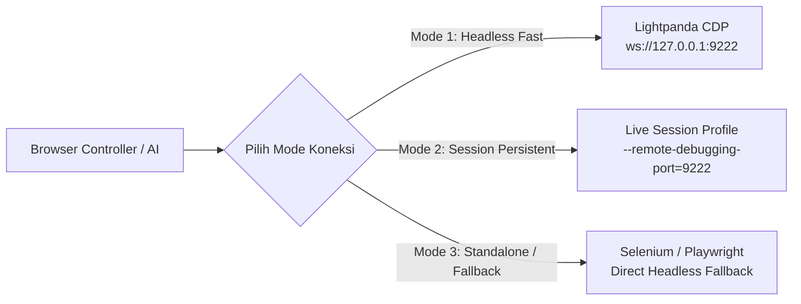

# Referensi: Otomasi Browser & Penarikan Laporan Portal Web ERP

Dokumen ini memuat standar otomasi peramban (browser automation) menggunakan Lightpanda CDP, Chrome/Edge Live Session Profile, dan driver fallback untuk mengekstraksi laporan keuangan dan operasional dari portal ERP berbasis web.

---

## 1. Arsitektur Konektivitas Browser

Otomasi browser mendukung 3 mode eksekusi yang fleksibel:



1. **Lightpanda CDP (`ws://127.0.0.1:9222`):**
   - Menggunakan browser engine berbasis Zig berkecepatan tinggi dengan konsumsi memori minimal (<100MB RAM).
   - Sangat optimal untuk navigasi batch berulang dan penarikan berkas laporan berskala masif.
2. **Live Session Profile (Profil Browser Aktif):**
   - Memanfaatkan sesi otentikasi nyata yang sudah login ke portal ERP target.
   - Menghindari keharusan meng-input kredensial berulang kali serta melewati mekanisme autentikasi multi-faktor atau pembatasan sesi.
3. **Smart Fallback Driver:**
   - Apabila service Lightpanda belum aktif, sistem otomatis beralih ke driver browser Python bawaan untuk memastikan proses penarikan laporan tidak terputus.

---

## 2. Navigasi & Pola Interaksi Form Web ERP

Pada portal ERP berbasis web, form penarikan laporan umumnya menggunakan kombinasi Select2/Dropdown cabang, input rentang tanggal, dan modal konfirmasi ekspor.

### A. Penanganan Dropdown Entitas & Multi-Cabang
* Jangan berasumsi daftar cabang/entitas bersifat statis. Selalu baca elemen `<select name="branch_id">` atau opsi dropdown dinamis langsung dari DOM.
* Lakukan iterasi sekuensial untuk seluruh entitas/cabang yang aktif.
* Berikan jeda waktu eksplisit (0.5 – 1.5 detik) setelah memilih cabang agar event AJAX pengisian data kategori, gudang, atau sub-unit selesai dimuat sempurna sebelum mengeklik tombol submit.

### B. Penanganan SweetAlert & Modal Konfirmasi
* Banyak portal web menampilkan modal dialog (contoh: SweetAlert2 `swal2-confirm`) saat mengekspor laporan besar.
* Agen wajib mendeteksi kemunculan elemen modal konfirmasi dan mengeklik tombol konfirmasi ekspor sebelum menunggu sinyal unduhan berkas.

---

## 3. Protokol Unduhan Ketat (Strict File Downloader)

Untuk menjaga keamanan sistem dan mencegah berkas sampah tersimpan:

```text
┌────────────────────────────────────────────────────────┐
│ Filter Ekstensi Dokumen: HANYA .xlsx, .xls, .csv, .pdf │
├────────────────────────────────────────────────────────┤
│ Validasi Magic Bytes:                                  │
│ - Spreadsheet XLSX : PK\x03\x04 (ZIP signature)        │
│ - Spreadsheet XLS  : \xd0\xcf\x11\xe0 (OLE2 header)    │
│ - Dokumen PDF      : %PDF                              │
└────────────────────────────────────────────────────────┘
```

1. **Pencegahan Penyimpanan Error HTML:**
   Bila sesi login expired atau terjadi HTTP 500/404, server web sering kali mengembalikan laman HTML error namun dinamai dengan ekstensi `.xlsx`. Validasi Magic Bytes langsung menggagalkan berkas tersebut sebelum masuk ke pipeline database.
2. **Penamaan Berkas Deterministik:**
   Setiap berkas yang diunduh disimpan dengan format terstandar:
   `<unit_cabang>_<nama_modul>_<tgl_awal>_<tgl_akhir>_<timestamp>.<ext>`

---

## 4. Pengorganisasian Folder & Manifest Kriptografi

Setelah berkas masuk ke direktori penampungan sementara (`downloads/`), modul organizer bertugas:
1. **Memilah ke Struktur Folder:**
   `structured_reports/<project_name>/<YYYY-MM>/<kategori>/<excel|pdf>/`
2. **Kalkulasi Checksum (MD5 & SHA-256):**
   Mendeteksi duplikasi berkas secara kriptografis untuk mencegah data ganda.
3. **Penyusunan Manifest:**
   Merekam metadata berkas ke `manifest.json` dan `manifest.csv`:
   - `file_id`: UUID unik berkas.
   - `file_name`: Nama berkas di disk.
   - `file_size_bytes`: Ukuran riil berkas.
   - `md5` & `sha256`: Hash integritas konten.
   - `source_url`: URL asal pengunduhan.
   - `download_timestamp`: Waktu presisi pengambilan data.

---

## 5. Ingesti Dinamis ke Database Relasional (MySQL / SQLite / PostgreSQL)

1. **Ekstraksi Skema Otomatis (Schema Inference):**
   - Membaca baris pertama sheet Excel sebagai kandidat nama kolom.
   - Membersihkan karakter spasi, tanda kurung, dan kata kunci terlarang SQL (`SELECT`, `WHERE`, `ORDER`, `GROUP`).
   - Menganalisis sampel isi kolom untuk menentukan tipe data SQL:
     - Angka desimal kuantitas/nominal $\rightarrow$ `DECIMAL(18,4)`.
     - Teks pendek $\rightarrow$ `VARCHAR(255)`.
     - Teks panjang / catatan $\rightarrow$ `TEXT`.
     - Tanggal $\rightarrow$ `DATETIME` atau `DATE`.
2. **Pembuatan Tabel Dinamis:**
   Menjalankan query `CREATE TABLE IF NOT EXISTS rep_<nama_file>_<nama_sheet> (...)`.
3. **Batch Insertion:**
   Data di-insert menggunakan *parameterized bulk query* dengan ukuran batch 500–1.000 baris per eksekusi untuk efisiensi transfer data.
