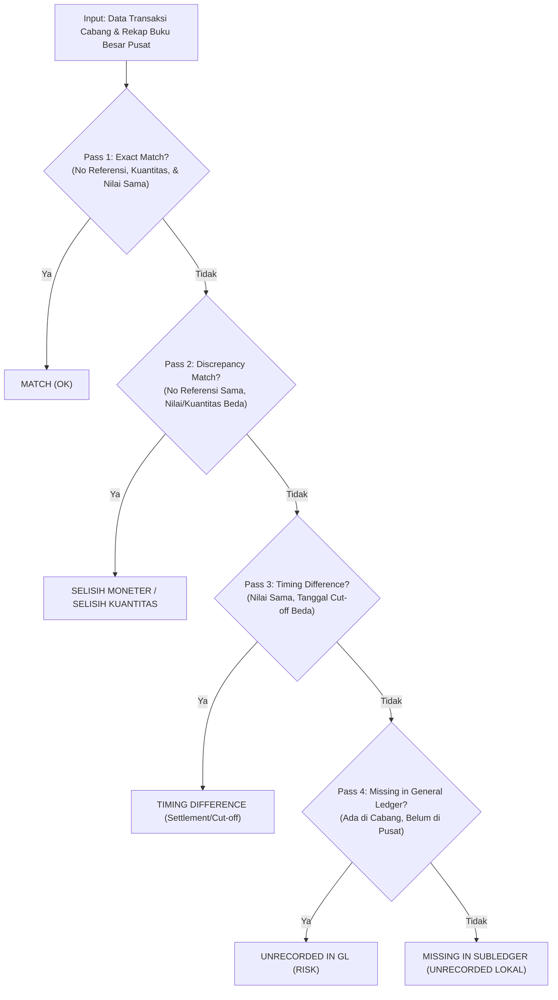

# Referensi: Rekonsiliasi Akuntansi Multi-Unit & Dual-Dimension

Dokumen ini memuat panduan komputasi finansial dan fisik (Multi-Unit / Dual-Dimension) untuk industri dengan karakteristik pencatatan bernilai ganda (moneter dan kuantitas presisi).

---

## 1. Konsep Dasar: Mengapa Rekonsiliasi Multi-Unit Diperlukan?

Dalam akuntansi konvensional, rekonsiliasi sering kali hanya berfokus pada dimensi moneter (saldo kas, mutasi rekening, dan nilai buku Rupiah/Valas). Namun pada bisnis komoditas, manufaktur, retail bernilai tinggi, atau perdagangan multi-satuan:
1. Setiap transaksi memiliki **kuantitas fisik atau bobot presisi tinggi** (misal: 2 hingga 4 angka di belakang desimal).
2. Terdapat variasi spesifikasi kualitas, kadar kemurnian, grade, atau nomor batch/lot.
3. Selisih pecahan kecil pada kuantitas fisik (misal: 0.01 unit atau gram) memiliki nilai moneter yang material.
4. Fluktuasi harga pasar harian membuat nilai buku moneter dapat bergerak independen terhadap kuantitas fisik, sehingga audit **wajib memverifikasi kedua dimensi secara terpisah namun simultan**.

---

## 2. Struktur Transaksi Finansial & Fisik

Setiap baris transaksi operasional idealnya dipecah menjadi komponen:
$$\text{Total Transaksi} = (\text{Kuantitas Bersih / Bobot Netto} \times \text{Harga Satuan Dasar}) + \text{Biaya Jasa / Ongkos Pengerjaan} \pm \text{Pajak / Diskon}$$

### A. Dimensi Fisik (Physical Quantity Dimension):
* **Kuantitas Kotor (Gross Quantity / Weight):** Bobot atau kuantitas total sebelum eliminasi pembungkus, pengotor, atau komponen non-utama.
* **Potongan Tara / Komponen Tambahan (Tare / Secondary Material):** Nilai pengurang bobot fisik non-utama.
* **Kuantitas Bersih (Net Quantity / Weight):** Nilai fisik riil yang menjadi dasar valuasi persediaan dan perhitungan harga pokok penjualan (HPP).

### B. Dimensi Finansial (Financial Dimension):
* **Nilai Dasar Barang:** Perkalian kuantitas bersih dengan harga per satuan.
* **Biaya Jasa Tambahan (*Making Fee / Processing Cost*):** Biaya pemrosesan yang melekat pada barang saat dijual namun dapat diperlakukan berbeda saat retur atau buyback.
* **Kompensasi Pengembalian (*Buyback / Trade-In*):** Transaksi penerimaan kembali barang dari pelanggan dengan perhitungan potongan susut nilai atau penyesuaian harga pasar.

---

## 3. Pemisahan Entitas: Pembelian Putus vs Konsinyasi (Titipan)

| Aspek Akuntansi | Pembelian Putus (Direct Purchase) | Konsinyasi (Consignment / Titipan) |
|:---|:---|:---|
| **Kepemilikan Legal** | Berpindah langsung ke perusahaan saat serah terima | Tetap menjadi milik pemilik barang (pihak ketiga) |
| **Pengakuan Hutang** | Hutang dagang diakui saat faktur penerimaan terbit | Hutang baru diakui saat barang berhasil terjual ke konsumen |
| **Pencatatan Saldo** | Subledger Hutang Usaha (*Accounts Payable Subledger*) | Akun Titipan / Saldo Deposit Konsinyasi |
| **Penyelesaian** | Pembayaran faktur via transfer bank, kas, atau barter fisik | Pemotongan deposit titipan atau settlement berkala atas unit terjual |

> [!WARNING]
> Jangan pernah menggabungkan saldo hutang pembelian putus dengan saldo titipan konsinyasi dalam satu akun, meskipun berasal dari entitas rekanan yang sama.

---

## 4. Algoritma 5-Pass Matching (General Ledger vs Subledger / Kasir)

Saat mencocokkan data transaksi internal operasional dengan buku besar atau rekapitulasi audit:

---

## 5. Rumus Universal Pembuktian Saldo (Balance Proof Formula)

Untuk memverifikasi kebenaran saldo berjalan setiap akun persediaan, hutang, maupun piutang:
$$\text{Saldo Akhir Hitung} = \text{Saldo Awal} + \sum \text{Arus Masuk (Inflow)} - \sum \text{Arus Keluar (Outflow)}$$

1. **Komponen Arus Masuk (Inflow / Debit Persediaan):**
   - Penerimaan barang dari faktur pembelian baru.
   - Penerimaan titipan konsinyasi baru.
   - Retur penjualan dari pelanggan.
   - Mutasi transfer masuk antar-gudang atau antar-rekanan.
2. **Komponen Arus Keluar (Outflow / Kredit Persediaan):**
   - Penjualan barang ke pelanggan.
   - Retur barang rusak/cacat ke supplier.
   - Pengembalian barang konsinyasi ke pemilik barang.
   - Mutasi transfer keluar ke unit lain.
3. **Penyelidikan Anomali Saldo:**
   Apabila ditemukan kondisi anomali seperti $\text{Outflow} > (\text{Saldo Awal} + \text{Inflow})$:
   - Periksa potensi kesalahan ketik (*typo*) pada desimal timbangan atau kuantitas.
   - Periksa dokumen penerimaan fisik yang barangnya sudah diterima gudang namun fakturnya belum di-input ke sistem.
   - Periksa potensi percampuran pencatatan antara barang milik sendiri dengan barang titipan konsinyasi.
   - Periksa catatan memo mutasi fisik antar-supplier yang belum dibukukan.
